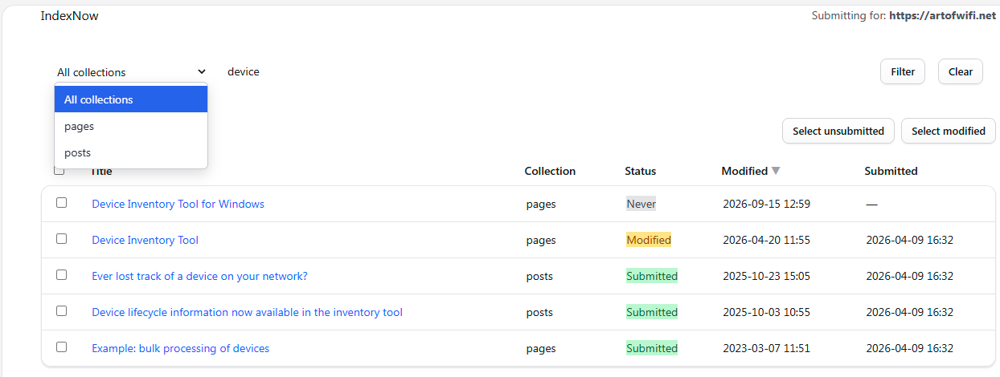

# IndexNow for Statamic

Submit URLs to [IndexNow](https://www.indexnow.org/) directly from your Statamic Control Panel for faster search engine indexing.

## What is IndexNow?

[IndexNow](https://www.indexnow.org/) is an open protocol that allows websites to instantly notify search engines about content changes. Instead of waiting for search engines to discover updates through crawling, IndexNow enables real-time notifications resulting in faster indexing and more current search results.

When you submit to any one participating search engine, the submission is shared with all other IndexNow-enabled engines. [indexnow.org](https://www.indexnow.org/searchengines.json) currently lists these participants:

- **Bing**
- **Yandex**
- **Seznam**
- **Naver**
- **Yep**
- **Amazon** (Amazonbot)
- **Internet Archive**

Each engine decides on its own whether and when to crawl and index a submitted URL. Submitting a URL does not guarantee that it gets indexed.

> **Note:** Google does not participate in IndexNow. Use [Google Search Console](https://search.google.com/search-console) for Google indexing.

## Features

- **CP Utility** — browse all published entries and submit selected URLs with one click
- **Submission tracking** — see which entries have been submitted and whether they've been modified since
- **Auto-submit on publish** — optionally submit URLs automatically when entries are saved
- **Bulk actions** — quickly select all unsubmitted or modified entries
- **Collection filtering** — filter entries by collection and search by title
- **Sortable columns** — sort by title, collection, status, last modified, or last submitted
- **Batch support** — large submissions are automatically chunked per IndexNow's 10,000 URL limit
- **History cleanup** — artisan command to prune old submission records

## Requirements

- Statamic 5 or 6
- Laravel 11, 12, or 13

## Installation

```bash
composer require artofwifi/statamic-indexnow
```

No database required. Submission history is stored as a JSON file in `storage/statamic-indexnow/`.

## Setup

### 1. Generate an IndexNow key

Your API key must be 8-128 characters long and may only contain lowercase letters (`a-z`), uppercase letters (`A-Z`), numbers (`0-9`) and dashes (`-`). You can generate one at [indexnow.org/genkey](https://www.indexnow.org/genkey) or use OpenSSL:

```bash
openssl rand -hex 32
```

### 2. Add the key to your `.env`

```env
INDEXNOW_KEY=your-key-here
```

IndexNow says only you and the search engines should know the key, so keep it out of version control.

### 3. Host the verification key file

To prove you own the host, IndexNow requires a UTF-8 encoded text file named `{your-key}.txt` at the root of your production domain. The file contains only the key. In a typical Statamic install you place it in the `public/` directory so it's served at:

```
https://yourdomain.com/your-key-here.txt
```

The file must be publicly accessible. Search engines fetch it to verify your submissions and keep using the key until you change it. Submissions send this root location as `keyLocation`. IndexNow also lets you host the key file elsewhere, but this addon only uses the root location (the option IndexNow recommends).

A few things to keep in mind:

- **One host per key file.** Every submitted URL must belong to the host of your production URL. Each subdomain (for example `www.` vs. bare domain, or `blog.`) counts as a separate host and needs its own key file.
- **Rotating the key.** To rotate, generate a new key, replace the key file, and update `INDEXNOW_KEY`. Search engines re-verify the new key on their own.

That's it! Head to **CP > Utilities > IndexNow** and start submitting.

## Configuration

Publish the config file if you need to customize settings:

```bash
php artisan vendor:publish --tag=statamic-indexnow-config
```

This will create `config/statamic-indexnow.php` with the following options:

```php
return [
    // Your IndexNow API key
    'key' => env('INDEXNOW_KEY'),

    // IndexNow endpoint (any participating engine shares with all others)
    'endpoint' => env('INDEXNOW_ENDPOINT', 'https://api.indexnow.org/indexnow'),

    // Base URL for submitted entries (useful when submitting from a dev environment)
    'production_url' => env('INDEXNOW_PRODUCTION_URL', env('APP_URL')),

    // Automatically submit URLs when entries are published or updated
    'auto_submit' => env('INDEXNOW_AUTO_SUBMIT', false),

    // Collection handles to exclude from the utility and auto-submission
    'exclude_collections' => [],

    // Max URLs per API request (IndexNow protocol limit is 10,000)
    'batch_size' => 10000,
];
```

### Production URL

If you manage your site from a development or staging environment, set `INDEXNOW_PRODUCTION_URL` to ensure production URLs are submitted regardless of which environment the CP runs in:

```env
INDEXNOW_PRODUCTION_URL=https://yourdomain.com
```

The host of this URL is sent as the `host` of each submission, and the key file must be reachable at `{production_url}/{key}.txt`. Use the exact host your site is served on (including or excluding `www.`). If you don't, IndexNow rejects the submission because the URLs don't belong to the host.

### Endpoint

By default, submissions go to the global endpoint `https://api.indexnow.org/indexnow`. You can send them to a specific search engine's endpoint instead (for example `https://www.bing.com/indexnow`). The submission is still shared with all participating engines either way.

### Excluding collections

Add collection handles to `exclude_collections` to hide them from the utility and skip them during auto-submission:

```php
'exclude_collections' => ['internal', 'drafts'],
```

## Usage

### CP Utility

Navigate to **Utilities > IndexNow** in the Control Panel. You'll see all published entries with their submission status:



| Status | Meaning |
|---|---|
| **Never** (gray) | Entry has never been submitted to IndexNow |
| **Modified** (amber) | Entry was modified after the last submission |
| **Submitted** (green) | Entry hasn't changed since last submission |

Select entries and click **Submit Selected to IndexNow**. Use the quick-select buttons to select all unsubmitted or modified entries.

The table supports sorting by title, collection, status, last modified, and last submitted date. Filter by collection or search by title using the controls above the table.

### Auto-submit on publish

Enable automatic submission whenever entries are saved:

```env
INDEXNOW_AUTO_SUBMIT=true
```

When enabled, every save of a published entry triggers a submission to IndexNow. Entries in excluded collections, entries without a URL, and unpublished entries are skipped.

IndexNow asks you not to resubmit unchanged URLs, and not to submit the same URL many times a day unless its content changed meaningfully. Every submitted URL counts toward your site's crawl quota, and submitting too often can get you rate-limited (HTTP 429). Auto-submit doesn't throttle repeated saves, so if your editors save the same entry often, consider leaving auto-submit off and submitting from the utility instead.

> **Note:** IndexNow also accepts URLs that were deleted (returning 404/410) or redirected. This addon currently only submits published entries. Unpublishing or deleting an entry does not trigger a submission.

### Response codes

The addon records the HTTP status of every submission. These are the status codes IndexNow defines:

| Code | Meaning |
|---|---|
| `200 OK` | URLs submitted successfully. This only means the search engine received them, not that they will be indexed. |
| `202 Accepted` | URLs received, but key validation is still pending. |
| `400 Bad Request` | Invalid request format. |
| `403 Forbidden` | Key not valid (e.g. key not found, or the file was found but the key isn't in it). |
| `422 Unprocessable Entity` | URLs don't belong to the host, or the key doesn't match the protocol schema. |
| `429 Too Many Requests` | Too many requests (potential spam). |

The utility treats any `2xx` response as a successful submission. For other responses, it shows the error returned by the endpoint. Check your key, key file and production URL, avoid submitting too often, and then resubmit.

### Cleaning up old records

Submission history accumulates over time. Use the artisan command to prune old records:

```bash
# Delete records older than 90 days (default)
php artisan indexnow:prune

# Delete records older than 30 days
php artisan indexnow:prune --days=30
```

To run this automatically, add it to your schedule in `routes/console.php` or `app/Console/Kernel.php`:

```php
$schedule->command('indexnow:prune')->monthly();
```

## License

MIT License. See [LICENSE.md](LICENSE.md) for details.
